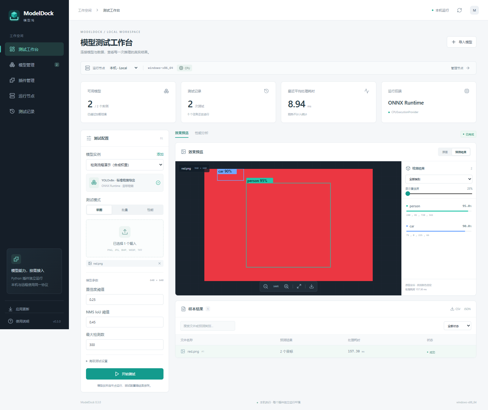
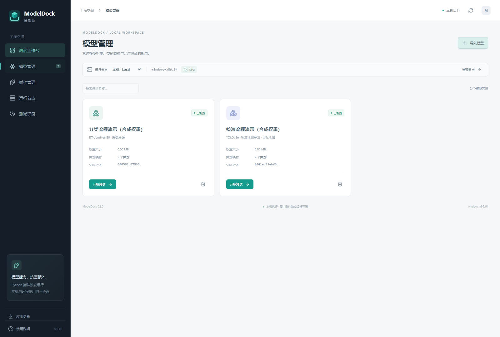
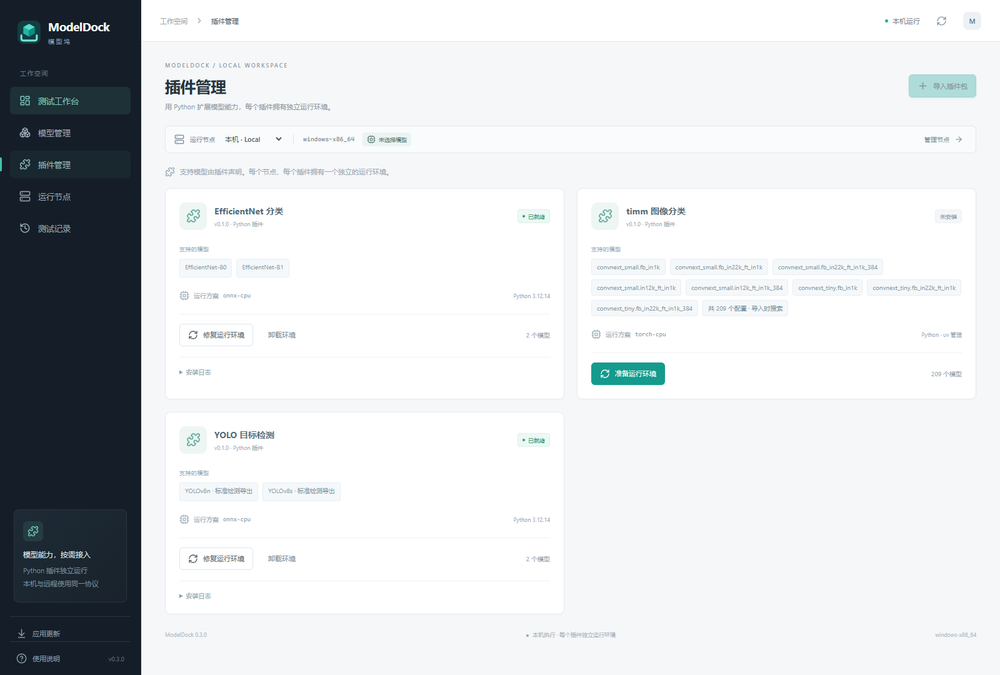
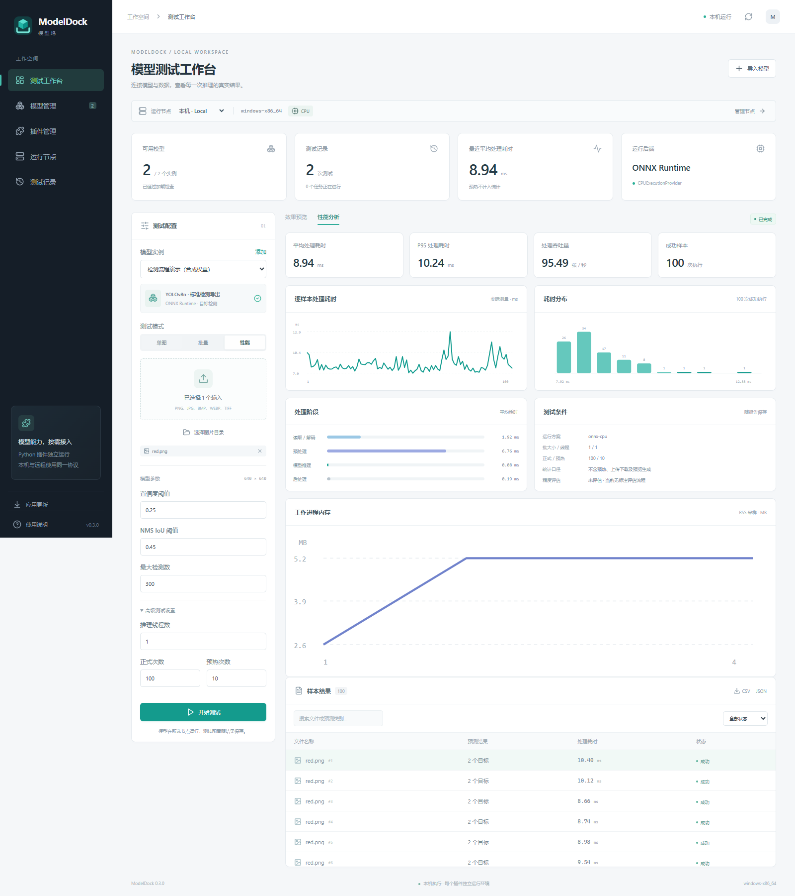

# ModelDock

[简体中文](README.md) | **English**

## Overview

ModelDock is a plugin-based Windows desktop tool for testing models locally or on Linux nodes over SSH. Manage models and runtime environments, test image classification and object detection, inspect results, and compare performance in one interface.

## Features

- **Local and remote testing**: Run models locally or on SSH Linux nodes, upload images, and retrieve results.
- **Model plugins**: Includes ONNX classification, YOLO detection, and timm image classification plugins, with a searchable pretrained configuration catalog and model family filters for timm.
- **Isolated environments**: Uses uv to isolate Python environments by node and plugin, with plugin ZIP import and environment installation, repair, and removal.
- **Flexible weight import**: Import local files, HTTP/HTTPS direct links, or official timm pretrained weights, with download progress, cancellation, retries, and optional SHA-256 verification.
- **Multiple test modes**: Test single images, image folders, batches, or performance after warmup; queue, cancel, and rerun tasks with the same configuration.
- **Visual results**: Switch between original and annotated images, link detection boxes with result lists, filter by class and confidence, zoom and pan, and export PNG results.
- **Performance analysis and comparison**: Inspect per-sample latency, distributions, P50/P95, throughput, stage timings, and process memory samples; compare test conditions.
- **History and reports**: Save model, input, and environment summaries, inspect per-item errors, and export JSON/CSV reports.
- **In-app updates**: Check for stable releases, verify update signatures, and install while preserving models, plugin environments, and test history.

The bundled plugins currently support CPU execution with batch=1. GPU, video, and accuracy evaluation against labeled data are not yet supported.

## Screenshots

Captured from the application's development preview. Test models use synthetic weights to demonstrate the interface and workflow; results and timings do not represent real model accuracy or performance. The interface shown is in Chinese.

### Test workbench

Configure test inputs and inspect detection boxes alongside the result list.

### Model management

Manage imported model instances and their validation status.

### Plugin management

Inspect supported models and runtime profiles, and prepare and maintain isolated environments.

### Performance analysis

Inspect latency statistics, distributions, and stage timings after warmup.

