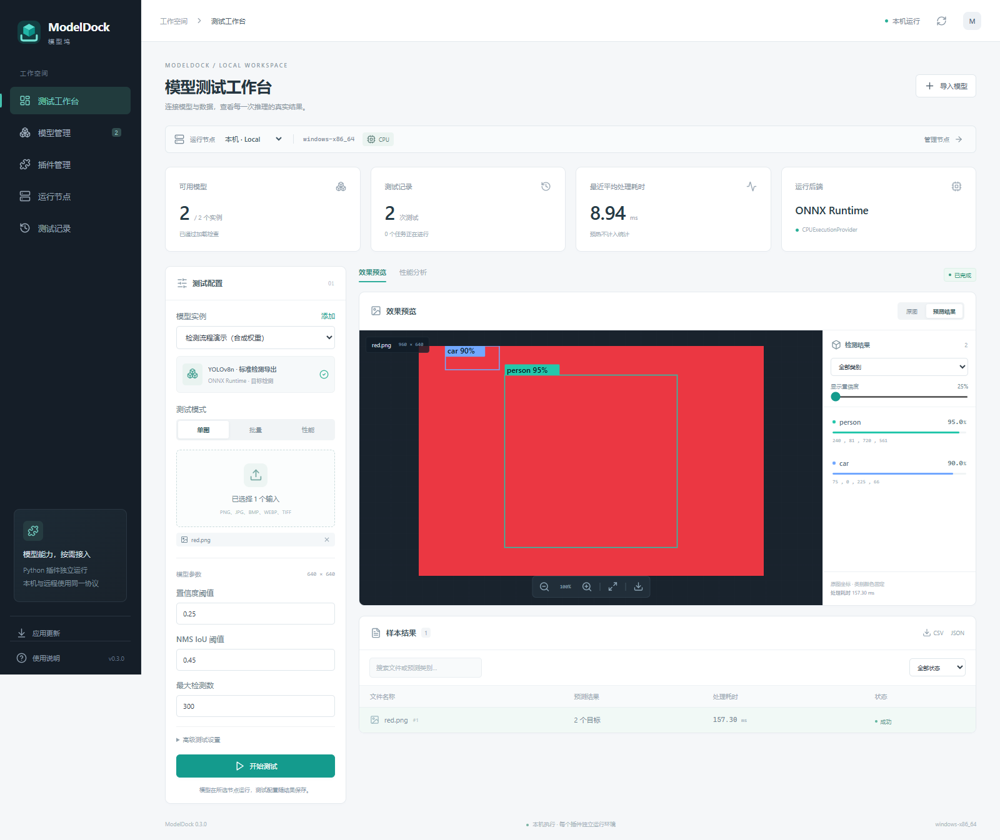
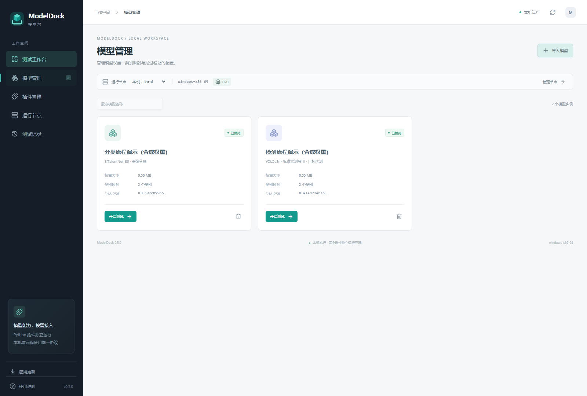
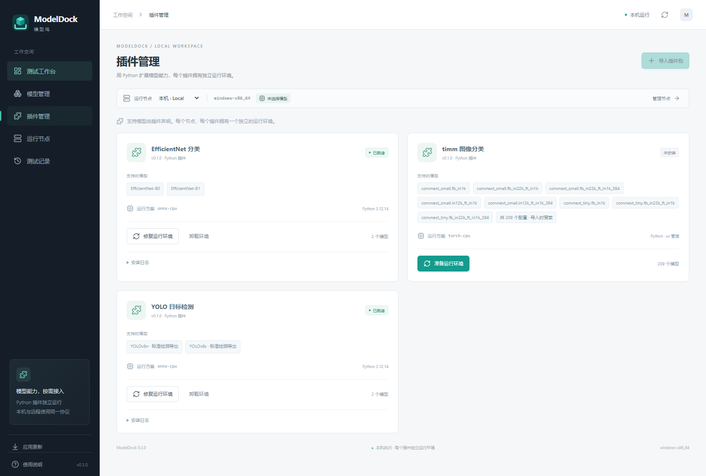
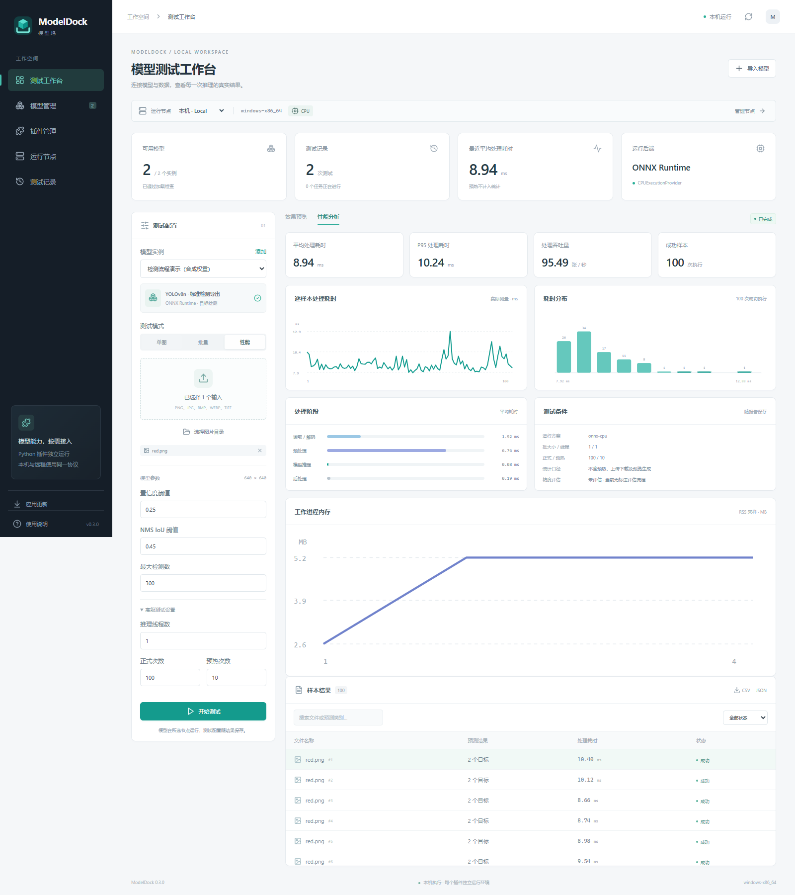

# ModelDock · 模型坞

**简体中文** | [English](README.en.md)

## 软件简介

ModelDock 是一款插件化的 Windows 桌面模型测试工具，支持在本机或通过 SSH 连接 Linux 节点运行模型。在统一界面中管理模型与运行环境、测试图像分类和目标检测、查看结果并比较性能。

## 软件特性

- **本机与远程测试**：本机运行，或在 SSH Linux 节点执行任务、上传图片与取回结果。
- **插件化模型接入**：提供 ONNX 分类、YOLO 检测与 timm 图像分类插件；timm 内置可搜索、按家族筛选的预训练配置目录。
- **独立运行环境**：使用 uv 为每个节点、每个插件隔离 Python 环境，支持插件 ZIP 导入及环境安装、修复和卸载。
- **灵活导入权重**：支持本地文件、HTTP/HTTPS 直链和 timm 官方预训练权重，提供下载进度、取消、重试与可选 SHA-256 校验。
- **多种测试模式**：支持单图、图片目录、批量与预热后的性能测试，可排队、取消和按原配置重测。
- **可视化结果**：原图与结果切换、检测框与列表联动、类别和置信度筛选、缩放拖动及 PNG 结果图导出。
- **性能分析与对比**：查看逐样本耗时、分布、P50/P95、吞吐量、分阶段计时与进程内存采样，对比不同测试条件。
- **历史记录与报告**：保存模型、输入和环境摘要，查看逐项错误，导出 JSON/CSV 报告。
- **应用在线更新**：检查稳定版更新，校验签名后安装，并保留模型、插件环境和测试记录。

当前内置插件仅支持 CPU、batch=1；尚不支持 GPU、视频及标注精度评估。

## 主要功能截图

截图来自实际应用的开发预览。测试模型使用合成权重，仅展示界面与流程，结果和耗时不代表业务精度或真实模型性能。

### 测试工作台

配置测试输入，预览检测框与结果列表。

### 模型管理

集中管理导入的模型实例与验证状态。

### 插件管理

查看支持的模型与运行方案，准备和维护独立环境。

### 性能分析

查看预热后的耗时统计、分布与分阶段计时。

